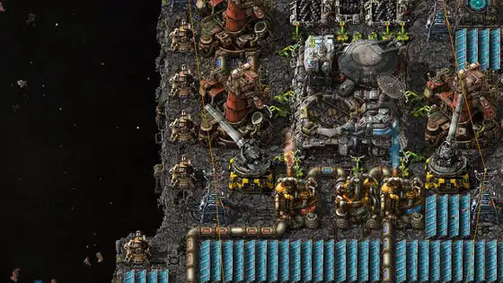
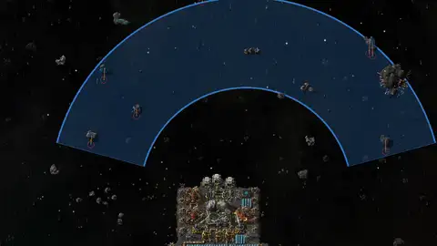
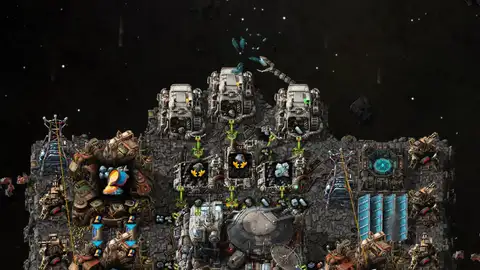
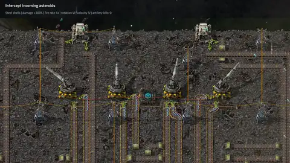
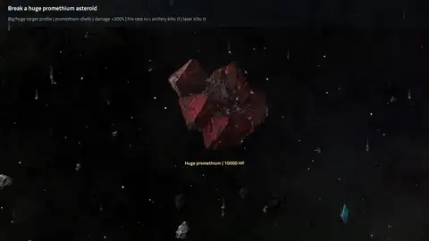
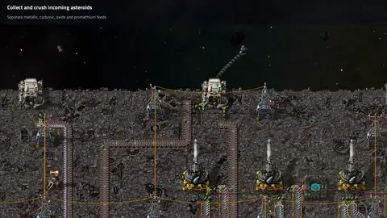
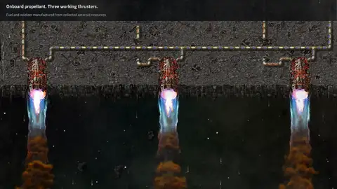

# Space Artillery

**Automated artillery defense against asteroids.** Requires Factorio 2.1 + Space Age.

Space platform artillery leads incoming asteroids and coordinates fire between
cannons to avoid overkill. A powered targeting computer selects asteroid sizes,
chunk types and firing sectors, with circuit network overrides. Shots that would
detonate near platform foundation are held back.

The mod adds steel and promethium artillery shells cast in space, plus research
for turret rotation speed and shell velocity. Computer settings persist in
blueprints and can be configured on ghosts before construction.

## Showcases

**Shell follow** shows the launch, flight in slow motion, and interception.



| Sector control | Compact production |
| --- | --- |
|  |  |

| Battery combat | Promethium impact |
| --- | --- |
|  |  |

| Asteroid-to-ammunition factory | Ship overview |
| --- | --- |
|  |  |

The compact ship casts its own shells with steel made from collected chunks.
It carries radars and explosives as cargo. The larger factory makes its
components and propellant onboard. [Capture notes](docs/capture-notes.md)

See the [mod description](docs/mod-portal.md) for research progression, ammunition
stats, computer controls and compatibility.

## Build and install

```sh
make package
```

This builds `dist/space-artillery_<version>.zip`. Copy it into Factorio's mods
directory and enable **Space Artillery** in the game. `make install` builds and
copies it automatically; set `FACTORIO_MODS` to use a custom mods directory.
Packaging requires Bash, Make, rsync and zip.

## Development

Mod sources are in [mods/space-artillery](mods/space-artillery). Tests require
Factorio 2.1.24 or later, Space Age and Python 3. The runner defaults to the macOS
Steam installation; set `FACTORIO` to the executable's absolute path elsewhere.

| Command | Purpose |
| --- | --- |
| `make test` | Run all 20 local functional cases, including save/reload. |
| `make test-smoke` | Run the short technology, prototype and GUI checks. |
| `make test-demos` | Check production and combat in both capture scenarios without rendering. |
| `make play` | Open the interactive playtest ship. |
| `./tools/capture-clips.sh` | Render and encode the compact-ship recordings into `tmp/clips/` for review. |

See [testing instructions](docs/testing.md) for coverage and individual cases.
[Capture instructions](docs/capture-notes.md) cover rendering and encoding;
captures open a game window and require FFmpeg and Python 3.
