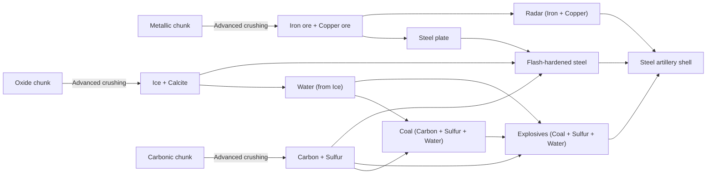

# Awesome Artillery — Space Artillery Shell Design

Date: 2026-11-08 · Target: Factorio 2.1.24+ with Space Age ·
Status: implemented

## Intent

Make space platforms capable of manufacturing their own artillery shells from asteroid
resources, without replacing the vanilla tungsten shell.

In vanilla Space Age, `artillery-shell` requires `4× tungsten-plate`, `1× calcite`,
`8× explosives` and `1× radar`. Three of those four ingredients can already be made in
space—and form a great space-chemistry puzzle (Carbonic chunks → Carbon + Sulfur + Water
→ Coal Synthesis → Explosives). Only **Tungsten** is hard-locked to Vulcanus imports.

Rather than adding artificial surface restrictions or scripted planet penalties, this
design adds a **Steel artillery shell** (`aa-steel-artillery-shell`) made via an
intermediate **Flash-hardened steel** (`aa-flash-hardened-steel`) that requires
carburizing steel with **carbon** and **calcite** flux and quenching it in **ice**:

- **On a space platform:** Advanced Oxide Crushing outputs **Ice** and **Calcite**
  together from the same crusher, Carbonic Crushing outputs **Carbon** and **Sulfur**,
  and Metallic Crushing outputs **Iron** and **Copper**. Every ingredient comes from the
  three asteroid types.
- **On planets:** **Calcite** (Vulcanus) and **Ice** (Fulgora / Aquilo) never occur on
  the same planet natively, and Vulcanus already has infinite Tungsten right next to its
  Calcite. So the recipe is naturally space-bound by resource geography alone.

## Goals

1. A space platform with **Advanced Asteroid Processing** can manufacture artillery
   shells indefinitely from Metallic, Carbonic and Oxide asteroid chunks.
2. The production chain requires all three asteroid types and uses both outputs of
   Advanced Oxide Crushing (`ice` + `calcite`).
3. At baseline research, the space shell performs nearly as well as the vanilla tungsten
   shell against **Small**, **Medium** and **Big** asteroids.
4. With artillery damage research, the space shell **scales more slowly** against Big
   asteroids and **never becomes viable against Huge asteroids**, preserving the role of
   imported Vulcanus tungsten shells for heavy / promethium ships.
5. Vanilla's overkill avoidance and the mod's max-shells eligibility check both account
   for whichever shell is loaded.

## Non-goals

- Surface restrictions (`surface_conditions`) or scripted atmospheric drag penalties.
  Resource geography (`calcite` + `ice` + `carbon`) already makes planetary production
  impractical compared to tungsten shells.
- Fluid byproducts (e.g. steam from ice quenching) that would require fluid-disposal
  plumbing on space platforms. All recipe inputs and outputs are belt-friendly solids.

## Items, recipes and technology

### Intermediate: Flash-hardened steel (`aa-flash-hardened-steel`)

Heating steel with carbon and a calcium carbonate (`calcite`) flux, then quenching in
`ice`, produces a hard, brittle martensitic steel casing: strong fragmentation on
detonation, but lacking tungsten's 19.3 g/cm³ density for kinetic armor penetration.

- **Prototype:** `type = "item"`, `subgroup = "raw-material"`,
  `order = "b[chemistry]-z[flash-hardened-steel]"`, `stack_size = 50`,
  `weight = 2 * kg`.
- **Icon:** `steel-plate` icon tinted `{0.7, 0.85, 1}`.
- **Recipe (`aa-flash-hardened-steel`):**
  - `category = "crafting"` (any assembler), `energy_required = 8`, `enabled = false`,
    `allow_productivity = true`.
  - Ingredients:
    - `2× steel-plate`
    - `2× carbon`
    - `1× calcite`
    - `2× ice`
  - Result: `1× aa-flash-hardened-steel`.

### Ammo: Steel artillery shell (`aa-steel-artillery-shell`)

- **Prototype:** `type = "ammo"`, `ammo_category = "artillery-shell"`,
  `subgroup = "ammo"`, `order = "d[explosive-cannon-shell]-d[artillery]-b[steel]"`,
  `stack_size = 1`, `weight = 100 * kg` (matches vanilla `artillery-shell`).
- **Icon:** `artillery-shell` icon tinted `{0.7, 0.85, 1}`.
- **Recipe (`aa-steel-artillery-shell`):**
  - `category = "crafting"` (any assembler), `energy_required = 15`, `enabled = false`.
  - Ingredients:
    - `2× aa-flash-hardened-steel` *(total raw casing cost: 4 steel, 4 carbon, 2 calcite, 4 ice)*
    - `8× explosives`
    - `1× radar`
  - Result: `1× aa-steel-artillery-shell`.

### Technology unlock (`aa-steel-artillery-shell`)

A dedicated scripted trigger technology **`aa-steel-artillery-shell`** unlocks both
`aa-flash-hardened-steel` and `aa-steel-artillery-shell`:

- **Prerequisites:** `aa-targeting-computer` and `advanced-asteroid-processing`.
- **Research trigger (`research_trigger = {type = "scripted"}`):** Destroy **20 medium
  or larger metallic**, **20 medium or larger carbonic** and **20 medium or larger
  oxide** asteroids with artillery (`e.cause.type == "artillery-turret"`).
- Tracked per force in `storage.kills[force.index][chunk]` via a filtered
  `on_entity_died` handler (`{{filter = "type", type = "asteroid"}}`), calling
  `force.script_trigger_research("aa-steel-artillery-shell")` once all three counts
  reach 20 and prerequisites are researched.

### Full space-platform production tree



## Projectile and damage scaling

### Projectile (`aa-steel-artillery-projectile`)

Copied from `data.raw["artillery-projectile"]["artillery-projectile"]`, with the impact
area damage changed from `1000 physical + 1000 explosion` to:

- **`200 physical` + `800 explosion`** (radius `4`, same as vanilla).

Because `data-final-fixes.lua` loops over all `ammo` prototypes with
`ammo_category == "artillery-shell"` when applying `aa-shell-speed-multiplier`, both
shell types share the exact same flight speed (`starting_speed`) and lead calculation.

### Damage vs. asteroids across research levels

Asteroid HP and resistances (`decrease / percent`):

| Asteroid size | HP | Physical resist | Explosion resist |
|---|---|---|---|
| Small | 100 | `0 / 0%` | `0 / 50%` |
| Medium | 400 | `0 / 10%` | `0 / 30%` |
| Big | 2000 | `2000 / 10%` | `0 / 10%` |
| Huge | 5000 | `3000 / 10%` | `0 / 99%` |

Resulting damage per shell (and shells to kill) by artillery damage bonus:

| Research bonus | Target | Vanilla Tungsten (`1000 phys + 1000 expl`) | Steel Shell (`200 phys + 800 expl`) |
|---|---|---|---|
| **+0%** (base) | Medium (400 HP) | 1600 (**1 shell**) | 740 (**1 shell**) |
| **+0%** (base) | Big (2000 HP) | 900 (**3 shells**) | 720 (**3 shells**) |
| **+50%** (lvl 5) | Big (2000 HP) | 1350 (**2 shells**) | 1080 (**2 shells**) |
| **+150%** (lvl 15) | Big (2000 HP) | 2700 (**1 shell** — phys clears 2000 armor) | 1800 (**2 shells** — phys still 0) |
| **+180%** (lvl 18) | Big (2000 HP) | 3180 (**1 shell**) | 2016 (**1 shell**) |
| **+300%** (lvl 30) | Huge (5000 HP) | 940 (**6 shells** — eligible) | 32 (**157 shells** — ignored) |
| **+500%** (lvl 50) | Huge (5000 HP) | 2760 (**2 shells**) | 48 (**105 shells** — ignored) |

Key properties of this curve:

- **Small and Medium asteroids:** always 1 shell.
- **Big asteroids:** starts at 3 shells (same as tungsten) and drops to 2 shells at +50%
  (same as tungsten), but misses the +100% physical armor breakpoint where tungsten
  damage surges into a 1-shot kill.
- **Huge asteroids:** steel shells only clear the 3000 flat physical armor at +1400%
  damage research (level 140). At realistic research levels they deal only ~1% of their
  explosion damage, so `eligible()` (`health / dmg <= max_shells`) never targets Huge
  asteroids with steel shells.

## Controller changes (`control.lua`)

### Overkill avoidance (no change needed)

Vanilla's predicted-damage check inspects the projectile of the ammo item loaded in each
turret against the decoy's `max_health` and `resistances`. Turrets loaded with
`aa-steel-artillery-shell` automatically predict 720 damage against a Big asteroid decoy
(and fire 3 shells), even if another turret on the same platform is loaded with vanilla
`artillery-shell`.

### Eligibility check (`shell_damage` and `scan_surface`)

Currently `control.lua` has a single `SHELL_DAMAGE = {physical = 1000, explosion = 1000}`
table used by `eligible(name, health, force, ctx)` to check `health / dmg <= ctx.max_shells`.

With two shell types:

1. Define a damage table per ammo prototype name:
   ```lua
   local SHELLS = {
     ["artillery-shell"] = {physical = 1000, explosion = 1000},
     ["aa-steel-artillery-shell"] = {physical = 200, explosion = 800},
   }
   ```
2. In `scan_surface`, while iterating the surface's valid artillery turrets, check what
   ammo is loaded (`t.get_inventory(defines.inventory.artillery_turret_ammo)`). Select
   the strongest shell currently loaded in any turret on the platform (defaulting to
   `"aa-steel-artillery-shell"` or `"artillery-shell"` if all turrets are empty) and
   store `ctx.shell` on the surface context.
3. Key the damage cache in `storage.damage` by `force.index`, `ctx.shell` and asteroid
   `name`.

This ensures a platform carrying only steel shells will not spawn decoys for Huge
asteroids at +300% research, while a platform carrying tungsten shells will.

## Testing

Extend `scenarios/playtest/control.lua`:

- **`tech` case:** verify `aa-flash-hardened-steel` and `aa-steel-artillery-shell` are
  locked at start, unlocked by `aa-targeting-computer`, and have the expected
  ingredients.
- **`steel-shell` case:** load turrets with `aa-steel-artillery-shell`, set damage
  bonus to +300% (where tungsten shells target and kill Huge asteroids), spawn a Medium,
  a Big and a Huge asteroid, and verify:
  - the Medium and Big asteroids get decoys and are killed without overkill;
  - the Huge asteroid gets **no decoy** and no shells are wasted on it.
